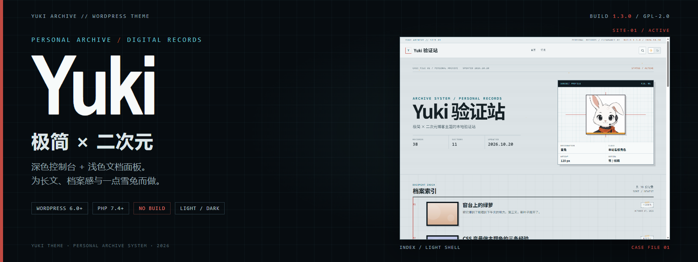

# Yuki — 极简 × 二次元 WordPress 主题

数字档案式版面：深色系统外壳包住浅色文档面板，首页以「CASE FILE / SUBJECT PROFILE /
DOCUMENT INDEX」组织内容，单篇保留 724px 正文列与 300px 侧栏。浅色模式下外壳跟随页面变浅，
深色模式保留控制台；雪兔是白底证件照卡，季节色只染卡片底边。

当前仓库版本 **1.3.0**，以 **GPL-2.0-or-later** 自托管分发（见下方「许可」）。
`main` 上已包含 v1.3.0 之后、尚未发版的改动。

**环境要求**：WordPress 6.0+，PHP 7.4+；无构建步骤，无 npm/composer 依赖。

## 安装

1. 将发行包（如 `yuki-1.3.0.zip`）上传到 WordPress 后台 → 外观 → 主题 → 安装主题 → 上传主题；
   也可解压到 `wp-content/themes/`，得到 `yuki/` 目录。
2. WordPress 后台 → 外观 → 主题 → 启用 **Yuki**。
3. 外观 → 菜单：创建菜单并指定到「主导航」位置；需要页脚链接组时再指定到「页脚链接组」。
4. 外观 → 自定义 → **Yuki 页脚设置**：填写 ICP 备案号 / 公安备案号（留空则显示占位）。
5. 外观 → 自定义 → **Yuki 头像设置**：Gravatar 在境内访问不了，国内主机请改选 Cravatar 或自填镜像地址。

## 从源码打包

需要 Node.js 22.2+ 和 Git，无需 WP-CLI 或安装 npm 依赖。在仓库内运行：

```bash
node tests/bin/package-theme.mjs
```

默认输出 `.scratch/release-prep/yuki.zip`，也可指定输出文件：

```bash
node tests/bin/package-theme.mjs /path/to/yuki.zip
```

要打某个标签或提交，而不是当前 `HEAD`，加 `--rev`：

```bash
node tests/bin/package-theme.mjs --rev v1.3.0 /path/to/yuki.zip
```

## 目录

```text
yuki-theme/
├── screenshot.png          后台「外观 → 主题」预览图（1200×900，浅色首页）
├── style.css               主题头 + 设计 Token + 基础样式
├── functions.php           主题设置、资源加载、自定义器
├── header.php              生产信息栏、导航、搜索、主题开关
├── footer.php              订阅区、页脚链接组、备案区、搜索浮层
├── index.php               首页：CASE FILE / 角色卡 / DOCUMENT INDEX
├── single.php              单篇：filebar、正文、目录、系列、侧栏
├── page.php                静态页面（单栏）
├── archive.php             归档：分类 / 标签 / 作者 / 日期 / 自定义分类法
├── search.php              搜索结果
├── 404.php                 未找到：FILE NOT FOUND
├── sidebar.php             SYSTEM NOTES：作者 / 一言 / 分类 / 标签墙 / 订阅 / 热门
├── comments.php            评论列表与表单
├── inc/
│   ├── production-bible.php   数字档案资源、统计与 body class
│   ├── components.php         组件 pattern 分类、样式与编辑器样式
│   ├── reading.php            目录 / 阅读进度 / 系列导航
│   ├── site-modules.php       数据条 / 标签墙 / 作者卡 / 订阅卡 / 页脚链接组
│   ├── comment-deletion.php   访客删掉自己写错的评论
│   ├── comment-likes.php      评论点赞与限流
│   ├── comment-submit.php     评论提交不刷新、回复落位
│   ├── related-posts.php      文章末尾的关联文章
│   └── shuoshuo-composer.php  说说归档里的前台发布
├── patterns/
│   ├── archive-note.php       档案注记
│   ├── archive-spec.php       规格表
│   ├── archive-timeline.php   时间线
│   ├── archive-evidence.php   证据图卡
│   └── archive-brief.php      双栏简报
├── template-parts/
│   ├── post-item.php          列表项（首页 / 归档 / 搜索共用）
│   ├── shuoshuo-item.php      说说条目
│   ├── shuoshuo-composer.php  说说写作框
│   ├── comment.php            单条评论
│   ├── comment-like.php       点赞控件
│   ├── mascot.php             雪兔照片卡
│   ├── related-posts.php      关联文章区块
│   ├── site-stats.php         数据条
│   ├── site-tag-wall.php      标签墙
│   ├── site-author-card.php   作者卡
│   ├── site-subscribe.php     订阅卡
│   └── site-footer-links.php  页脚链接组
├── assets/
│   ├── css/                   数字档案、组件、雪兔卡、站点模块样式
│   ├── js/                    主题开关、搜索、评论、灯箱、代码复制、目录、站点模块
│   └── images/                雪兔卡与证据图占位素材
├── languages/yuki.pot         翻译模板
└── tests/                     本地验证基建与验收脚本（不进发布包）
```

## 特性

### 数字档案界面

- **双表面**：深色系统外壳（状态栏、导航、hero、页脚）+ 浅色文档面板（正文、侧栏、顶栏、
  证据图框）。浅色模式下外壳跟随页面变浅；深色模式保留深色控制台。
- **首页**：CASE FILE 01 封面、SUBJECT PROFILE 角色卡、DOCUMENT INDEX 四列文章索引；
  记录数 / 分类数 / 最近更新来自站点真实数据。
- **单篇**：DOCUMENT / SECTOR / STATUS 顶栏、EVIDENCE 图卡、724px 正文列 + 300px 侧栏；
  侧栏与文章头部同顶开始。
- **浅色 / 深色**：头部滑动开关，偏好记忆在 localStorage，跟随系统偏好初始化（内联脚本防闪烁）。
- **外观设置**：自定义背景图/背景色与蒙层强度、页头横幅、强调色、字体（无衬线/衬线/圆体）。
- **宽度契约**：正文 768、wide 1120、容器 1120、侧栏 300、间距 48；编辑器对齐检查覆盖这些值。
- **动效收敛**：`prefers-reduced-motion` 只停运动、保留颜色；列表与上下篇 hover 1px 浮起。
- **视觉来源**：`DESIGN.md` + `style.css` + `assets/css/*`，不引入 `theme.json`（ADR 0003）。

### 阅读与内容

- **自动目录**：从正文 h2/h3 生成，少于 2 个标题不显示；桌面展开、窄屏折叠，点击更新 hash 与焦点，
  滚动时标记当前项。
- **阅读进度**：顶部进度条，`role="progressbar"`，减动效下无过渡。
- **系列导航**：在编辑器里给文章指定「系列」分类（`yuki_series`，不生成前台归档）；
  同系列 2 篇以上才显示，否则不占位。
- **代码块复制**：正文与说说代码块右上角复制按钮，支持剪贴板与旧接口回退，带读屏反馈。
- **图片灯箱**：正文与说说图片可点开看大图、图注；Esc / 遮罩 / 关闭按钮可关，焦点回到触发图。
- **关联文章**：同分类优先、同标签补足，最多 3 篇；无关联不占位，说说文章不显示。
- **说说**：独立分类归档，紧凑版式；归档顶部写作框，有 `publish_posts` 权限的作者可直接发布。
- **一言**：侧边栏随机一句，服务端取回并缓存一小时；上游失败时用主题自带句子兜底，
  访客浏览器不直接请求第三方。
- **侧边栏可配**：在「外观 → 小工具 → 文章侧边栏」放入任意小工具即接管，否则使用内置模块。

### 文章内组件

在编辑器里插入「图案 / Patterns」→「Yuki 档案组件」，五个 pattern 全部只用核心块：

- **档案注记**：左侧红线 + `NOTE / 01` 标签。
- **规格表**：字段 / 内容两列表格，带图注。
- **时间线**：日期 + 标题 + 说明的纵向节点。
- **证据图卡**：图片 + EVIDENCE 标签 + 图注；可替换占位图。
- **双栏简报**：两列并列说明，窄屏自动堆叠。

### 站点模块

- **数据条**：首页与归档复用，记录数 / 分类数 / 最近更新，不写死。
- **标签墙**：标签密集列表；超过 12 项默认收起，点击展开；无 JS 时完整展开。
- **作者卡**：只请求本站头像；无本地头像时显示姓名首字方块，避免 Gravatar 请求。
- **订阅卡**：侧栏邮件表单，沿用现有 `#newsletter` 行为，不新增第三方服务。
- **页脚链接组**：有「页脚链接组」菜单时使用菜单，否则回退到站点 / 索引 / 关于三组链接。

### 二次元点缀

- **雪兔**：AI 生成的胸像放进白底证件照卡，卡片有墨色边框与硬阴影；出现在首页 hero、404 与空状态。
- **季节色**：春樱粉、夏天蓝、秋琥珀、冬雪紫；只染雪兔卡底边、分类贴纸胶带与 hero 花瓣，
  正文、链接、按钮仍用主色。
- **分类贴纸**：轻微旋转的虚线徽章 + 半透明胶带；空状态文案装在朝上的气泡里。
- **hero 花瓣**：7 枚纯 CSS 樱瓣/星光；`prefers-reduced-motion` 下整层隐藏。

### 评论

- **防垃圾**：隐藏蜜罐 + 时间戳令牌；渲染到提交不足 3 秒会被挡下并给一句能照做的话。
- **待审评论对本人可见**；嵌套深度受限，深层回复压到第二层。
- **点赞**：每条评论一个控件，按访客 cookie 记状态；同一 IP 每分钟最多 60 次。
- **访客删掉自己写错的评论**：通过邮件里的链接，不需要注册或登录。
- **提交不刷新**：新评论就地出现；回复落在被回复的那条下面，表单回到底部。

### 工具与设置

- **搜索**：头部放大镜展开居中浮层，背景模糊，Esc / 点遮罩 / 再点按钮关闭。
- **头像镜像 / 备案号**：分别把头像源换成境内可达的 Cravatar 或自填镜像、把备案号链到查询站点。
- **编辑器**：直接使用同一套主题样式，字体、引用、代码块、组件与前台一致，画布约 720px。
- **国际化**：文案统一走 `yuki` 文本域，`languages/yuki.pot` 可直接交给译者。
  翻译文件放 `wp-content/languages/themes/yuki-{locale}.l10n.php`（或 `.mo`）。
- **无构建步骤，开箱即用。** 唯一的外部依赖是一言：只有它需要联网（服务端取回、缓存一小时），
  连不上时用主题自带的句子顶上，页面照常完整。

## 本地验收

测试只通过 HTTP 与无头 Edge 访问本地 WordPress，不使用 PHPUnit、Jest 或构建步骤：

```bash
# 先启动本地站，再跑全部验收
node tests/bin/verify-*.mjs
node tests/bin/verify-package.mjs
```

`tests/bin` 不进发布包；本地开发环境配置见 `docs/agents/handoff.md`。

## 许可

Yuki 以 **GPL-2.0-or-later** 发布，是 **100% GPL 兼容**的自由软件：可用于任何站点
（包括商业站点），也可以修改、再分发。完整条款见 [`LICENSE`](LICENSE)。

---

[](https://claude.ai/)

[](https://github.com/deepseek-ai/deepseek-harness)
